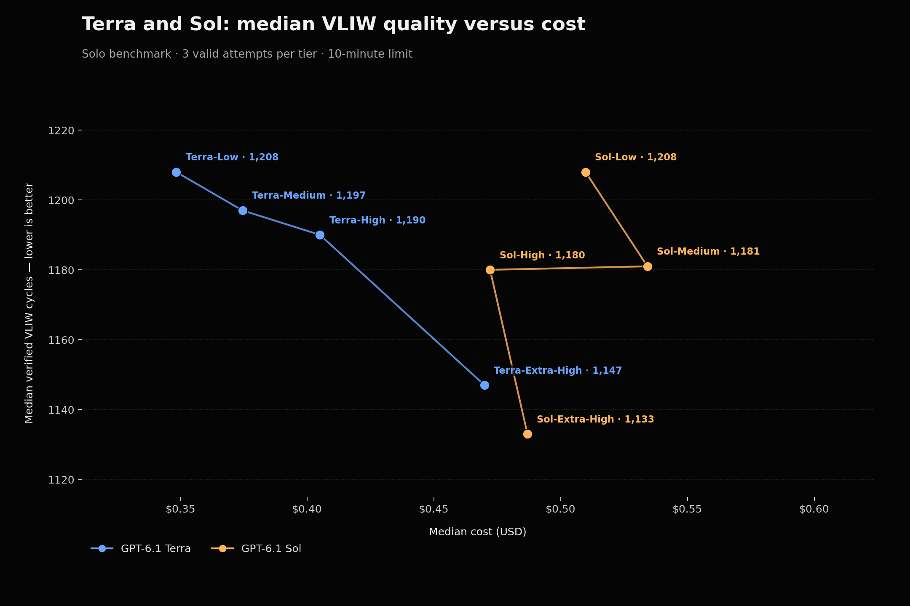

# Solo VLIW benchmark

Compare coding models on a frozen VLIW optimization challenge. Each attempt
uses one agent, a 600-second solver budget and an independent correctness and
cycle-count judge. Lower verified VLIW cycles are better.

The default campaign runs four reasoning tiers with three independent attempts
per tier. The solo preset uses zero workers; the Codex adapter disables native
multi-agent delegation and audits the resulting session. The underlying runner
still supports other configurations, but this repository's example and reported
results focus on solo attempts.

## Results



| Model | Reasoning | Valid cycle scores | Median cycles | Median cost, USD equivalent |
| --- | --- | --- | ---: | ---: |
| GPT-6.1 Terra | Low | 1,342; 1,208; 1,194 | 1,208 | $0.3483000–$0.3523248 |
| GPT-6.1 Terra | Medium | 1,144; 1,197; 1,315 | 1,197 | $0.3744614–$0.4017606 |
| GPT-6.1 Terra | High | 1,179; 1,190; 1,197 | 1,190 | $0.4050146–$0.4421260 |
| GPT-6.1 Terra | Extra-high | 1,178; 1,147; 1,130 | 1,147 | $0.4699286 |
| GPT-6.1 Sol | Low | 1,208; 1,284; 1,164 | 1,208 | $0.5097984 |
| GPT-6.1 Sol | Medium | 1,181; 1,320; 1,177 | 1,181 | ≥$0.5342032 |
| GPT-6.1 Sol | High | 1,180; 1,181; 1,164 | 1,180 | $0.4721420 |
| GPT-6.1 Sol | Extra-high | 1,124; 1,133; 1,399 | 1,133 | $0.4868876–$0.4913336 |

The chart plots separate medians for score and cost; they need not come from the
same attempt. For incomplete cost records it plots the lower bound of the median;
the table shows the corresponding possible range. Sol medium has no finite
upper bound. The lines connect reasoning tiers as visual guides and do not
represent interpolated measurements. [Machine-readable aggregate results](results/solo-terra-sol.json)
include unrounded values.

Costs are estimated standard-rate API equivalents for solver usage, not bills;
they exclude service-tier and long-context adjustments, setup and researcher
costs. The snapshots used per-million input / cached-input / output rates of
$1 / $0.05 / $5 for Terra and $2 / $0.10 / $10 for Sol. Missing usage is not
assumed to cost zero. Failed attempts and replacement usage are not included in
these per-valid-attempt medians, so they are not total campaign costs.

Both sets used the same version 2 challenge, task prompt, judge, 500-line
allowance and 600-second limit. All listed attempts passed the frozen judge's
nine held-out and eight upstream correctness cases. Sol used Codex CLI 0.163.0;
Terra used 0.164.0 with pinned base instructions and skill catalog. Historical
Sol injected context could not be fully recovered. The comparison is therefore
not a controlled model-only experiment. Three attempts per tier are descriptive;
they do not establish a general model ranking. Private traces and generated
solutions are not included in this repository.

## Run the benchmark

Requirements: Linux, Rust 1.75+, Python 3 and the selected model adapter. Build
and run the local tests; these do not launch models:

```sh
CARGO_TARGET_DIR=/tmp/vliw-benchmark-build cargo test --locked
CARGO_TARGET_DIR=/tmp/vliw-benchmark-build cargo build --locked
```

Review `examples.json` before use: the included model version and rates are
historical snapshots. Configure the installed CLI version, model, effort mapping
and appropriate pricing. `light` maps to the model's `low` effort in the
example. Model access and provider behavior are not established by a plan.
Credentials remain in the model CLI, not the configuration or repository.

Plan and freeze a solo campaign without contacting a model:

```sh
/tmp/vliw-benchmark-build/debug/harness-bench plan examples.json solo challenges/vliw.json
/tmp/vliw-benchmark-build/debug/harness-bench prepare examples.json solo challenges/vliw.json /tmp/my-benchmark
```

`prepare` requires a new directory and seals configuration, execution order,
challenge, runner and adapter hashes. The default plan is 12 attempts and up to
2 solver hours, excluding preparation and grading. Reduce `tiers` or `repeats`
to narrow the campaign. An unavailable model or effort is reported explicitly.

Only `run` contacts models and incurs usage. After reviewing the plan and costs:

```sh
/tmp/vliw-benchmark-build/debug/harness-bench run /tmp/my-benchmark
/tmp/vliw-benchmark-build/debug/harness-bench report /tmp/my-benchmark
```

Attempts run sequentially in a shuffled block per repeat, without grading
overlap. A started marker prevents accidental replay; interrupted campaigns
retain unfinished cells and do not resume automatically. Failures remain in the
report. A retry requires a new campaign and its cost remains attributable to the
experiment. Remove an owned campaign directory only after preserving the results
needed for recovery.

## How it works

The challenge manifest contains public starting files, protected fixtures,
checker, independent judge, scoring direction and file hashes. The supplied
version 2 VLIW package uses the original simulator, nine held-out inputs and
eight upstream correctness cases, with portable local checker and judge
adaptations recorded in the manifest's provenance. The agent can add at most
500 lines to its candidate and must select a checkpoint before the deadline.

The runner freezes the process and selected artifact at cutoff, checks the
selection receipt, source limits, protected files and adapter settings, then
grades the frozen copy with pristine fixtures. A cutoff overshoot above 100 ms
invalidates the attempt. Planning, preparation, grading and reporting are outside
the solver time limit. The process boundary is not a container or confidential
judge: use an external sandbox for untrusted or adversarial campaigns.

`codex_exec` uses a pinned non-interactive Codex CLI, disables user config,
host skill discovery, apps, tool network access and multi-agent delegation for
solo cells, and audits native session settings and token counters. The
`command_v1` adapter accepts a trusted agent loop, not a raw completion endpoint;
it must honor the same solo tools, deadline and checkpoint contract and report
one root context with actual model, effort and usage. Qualify adapters before
claiming comparable results. Missing or inconsistent telemetry does not become an
exact price. Adapter authentication is external to the configuration.

Reports retain individual scores, validity, observed time and accounting. The
runner's strict computed frontier includes only groups with every repeat valid
and exactly priced; the chart above instead displays all eight groups and makes
incomplete-cost bounds explicit here and in the data. This repository is an
extraction from the harness benchmark package; local tests use fake adapters
and judges and do not establish live model performance.

## Attribution and license

The Rust runner originated in the Apache-2.0-licensed
[yevhenx33/harness](https://github.com/yevhenx33/harness) project; see `LICENSE`.
The embedded fixtures are from [Anthropic's original performance take-home](https://github.com/anthropics/original_performance_takehome),
pinned to commit `5452f74bd977807ac2e74f3d29432b9df6f25197`. Their original
README and attribution are retained in the manifest. That commit contains no
standalone license file; the runner's license does not relicense those fixtures.
